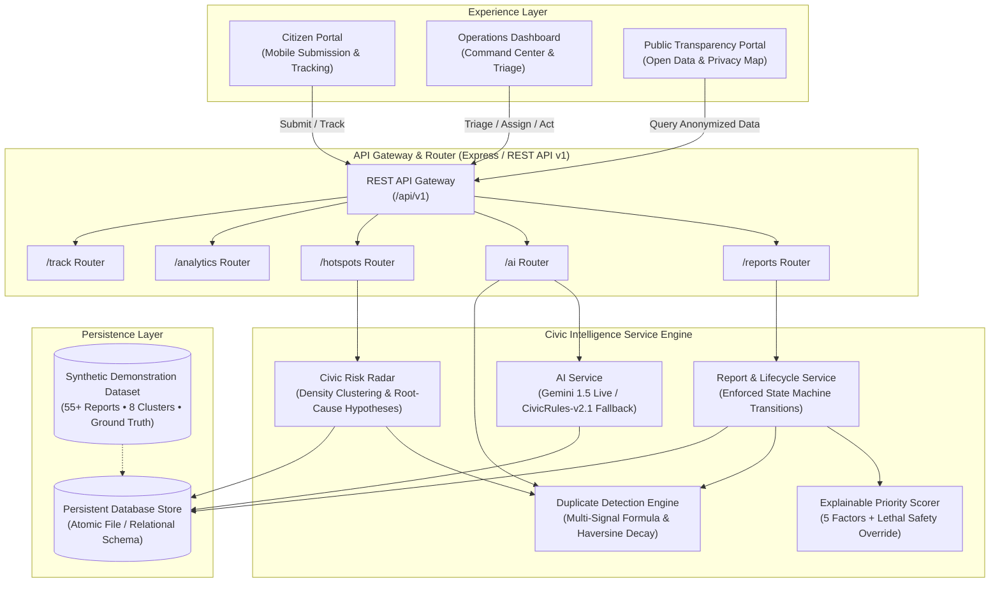

# CivicMind AI
### An AI-Powered Civic Intelligence, Urban Risk Detection & Public Action Platform

CivicMind AI is an enterprise-grade civic operations and geospatial intelligence platform. It converts unstructured citizen complaints into explainable, prioritized, and geographically coordinated municipal action across four interconnected lifecycle stages:

$$\textbf{CAPTURE} \longrightarrow \textbf{UNDERSTAND} \longrightarrow \textbf{REVEAL} \longrightarrow \textbf{ACT}$$

---

## 1. Executive Summary & Problem Statement

Cities face recurring, overlapping infrastructure failures:
- Clogged storm drains leading to localized waterlogging
- Persistent standing water eroding sub-base pavement into deep craters and potholes
- Uncovered manholes and live sparking wires presenting lethal pedestrian hazards
- Broken illumination corridors inducing crime risk near transit terminals

Traditional citizen reporting channels suffer from duplicate noise, missing spatial context, opaque priority assignments, and lack of accountability. Municipal dispatchers lack a unified lens to identify when multiple single complaints actually represent systemic root causes.

**CivicMind AI solves this with three distinct experiences:**
1. **Citizen Portal (`/`, `/report/new`, `/track`):** Mobile-first incident submission in under 45 seconds, automatic AI category suggestions, geolocation pin, and public status tracking.
2. **Civic Operations Dashboard (`/dashboard`, `/dashboard/map`, `/dashboard/reports`, `/dashboard/insights`, `/dashboard/hotspots`):** Dispatch command view, explainable 0–100 priority scoring with safety overrides, duplicate candidate triage, and cross-category Civic Risk Radar.
3. **Public Transparency Portal (`/public`):** Privacy-preserved open civic metrics, resolution performance, and public infrastructure health without disclosing citizen identities or confidential internal notes.

---

## 2. System Architecture



---

## 3. Technology Stack

- **Frontend:** React 18, TypeScript, Vite, Tailwind CSS, Lucide Icons, Recharts, Leaflet / Carto Dark Tiles.
- **Backend:** Node.js, Express, TypeScript, REST API v1 architecture, Zod request schema validation.
- **Database:** Persistent structured JSON/SQLite-compatible relational adapter with ACID atomic transactions, indexes, and migrations.
- **AI Engine:** Provider-independent dual architecture (Google Gemini 1.5 Flash API when `GEMINI_API_KEY` is present; transparent, calibrated deterministic `CivicRules-v2.1` fallback).
- **Testing:** Vitest, Supertest, automated unit & integration suites.

---

## 4. Key Differentiators & Mathematical Models

### 4.1 Explainable Priority Score (0 to 100)
Every report is evaluated across 5 documented, configurable dimensions:

$$\text{Priority Score} = S_{\text{safety}} + P_{\text{impact}} + I_{\text{disrupt}} + R_{\text{recurrence}} + T_{\text{unresolved}}$$

- **Immediate Safety Risk ($0 \le S \le 30$):** Open manholes, live wires, hazardous excavations, and accident history.
- **Public Impact ($0 \le P \le 25$):** Proximity to schools, hospitals, transit terminals, and pedestrian arterial routes.
- **Infrastructure Disruption ($0 \le I \le 15$):** Blocked arterial roadways, sewer overflows, water distribution mains.
- **Recurrence Factor ($0 \le R \le 15$):** Frequency of repeated occurrences and related complaint density.
- **Time Unresolved ($0 \le T \le 15$):** Age-based dynamic penalty ($0\text{--}12\text{h} \to 2$, $12\text{--}48\text{h} \to 6$, $48\text{--}120\text{h} \to 11$, $>120\text{h} \to 15$).

> **Safety Override Enforced:** Acute lethal hazards automatically elevate to a minimum score of **85 (CRITICAL)** with `safetyOverrideApplied: true` regardless of low recurrence or fresh submission age.

Priority Thresholds:
- **Critical:** $80 \le \text{Score} \le 100$
- **High:** $60 \le \text{Score} < 80$
- **Medium:** $35 \le \text{Score} < 60$
- **Low:** $0 \le \text{Score} < 35$

### 4.2 Semantic & Geospatial Duplicate Detection Formula
$$\text{Duplicate Score} = 0.50 \cdot \text{TextSim} + 0.25 \cdot \text{LocSim} + 0.15 \cdot \text{CatSim} + 0.10 \cdot \text{TimeSim}$$

- **Text Similarity ($\text{TextSim} \in [0, 1]$):** Combined token Jaccard set overlap and Dice coefficient with stopword filtering.
- **Location Similarity ($\text{LocSim} \in [0, 1]$):** Exponential decay using Haversine great-circle distance $d$ (meters):
  $$\text{LocSim} = \exp\left(-\frac{d}{180}\right)$$
  *(Incidents $>500\text{m}$ apart receive a physical distance gate penalty).*
- **Category Similarity ($\text{CatSim} \in [0, 1]$):** $1.0$ for identical category; $0.5$ for coupled physical pairs (e.g. *Drainage blockage* + *Waterlogging*).
- **Time Similarity ($\text{TimeSim} \in [0, 1]$):** Smooth temporal half-life decay: $\frac{1}{1 + (\Delta\text{hours} / 72)}$.

**Thresholds:**
- $\ge 0.70$: Strong candidate for triage confirmation.
- $0.45\text{--}0.69$: Possible match flagged for review.
- $< 0.45$: Unlikely match.

*Reports are NEVER automatically suppressed or deleted; duplicates are linked for human reviewer confirmation.*

### 4.3 Signature Feature: Civic Risk Radar
Spatial clustering ($r \approx 350\text{m}$) analyzes multi-category concentrations. When drainage blockage, standing water, and road craters coincide, the engine synthesizes an actionable hypothesis:
> *"Potential drainage-related infrastructure hotspot. 3 related reports recorded within cluster. Drainage blockage and recurring waterlogging may be contributing to accelerated road surface deterioration. Recommend joint inspection of stormwater culverts and sub-base road pavement by Water/Drainage and Road Maintenance teams."*

Distinguishes observed citizen facts from AI inferences.

---

## 5. Local Setup & Quickstart

### Prerequisites
- Node.js v18+ (tested on Node v20 & v26)
- npm v9+

### 1. Clone & Install Dependencies
```bash
git clone <repo-url> civicmind-ai
cd civicmind-ai
npm install
```

### 2. Configure Environment Variables
Copy `.env.example` to `.env`:
```bash
cp .env.example .env
```
*(Optional: add `GEMINI_API_KEY=your_key_here` to enable Google Gemini live model inference; otherwise the explainable deterministic rules fallback runs automatically).*

### 3. Initialize & Seed Demonstration Data
Populate the database with the verified 55-report synthetic dataset:
```bash
npm run seed
```

### 4. Run Automated Tests
Execute the 15-test unit & integration test suite:
```bash
npm test
```

### 5. Start Frontend & Backend
In terminal 1 (Backend API):
```bash
npm run dev:backend
# API running at http://localhost:3001
```

In terminal 2 (Frontend Client):
```bash
npm run dev:frontend
# App accessible at http://localhost:5173
```

---

## 6. Five-Minute Judge Demonstration Script

| Timestamp | Action | What to Showcase |
|---|---|---|
| **0:00–0:40** | **Introduce Problem** | Open `/`. Explain how unstructured citizen complaints overwhelm city halls. Highlight the 4-stage lifecycle and the live synthetic map preview. |
| **0:40–1:20** | **Submit Report** | Navigate to `/report/new`. Enter: *"Water has been collecting outside Lincoln school gate every morning. Storm drain appears clogged. Two-wheelers are slipping."* Notice instant AI category suggestion. Tap map pin. Click Submit. |
| **1:20–2:10** | **Explainable AI Scoring** | Inspect the newly generated tracking ID (`CM-2026-XXXX`). View the 0–100 Priority Score card. Show individual contributions: Safety (28/30), Impact (18/25), Infrastructure (10/15). Show the explainable summary. |
| **2:10–3:00** | **Civic Risk Radar Hotspot** | Open `/dashboard/insights` or `/dashboard/hotspots`. Show the Lincoln Elementary hotspot cluster. Demonstrate how the AI connects drainage blockage + waterlogging + road craters into a unified infrastructure hypothesis. Click *Create Action Brief*. |
| **3:00–4:00** | **Triage & State Transition** | Open the incident detail view (`/dashboard/reports/:id`). Assign to *Water Supply & Stormwater Drainage Authority*. Move status from `SUBMITTED` $\to$ `UNDER_REVIEW` $\to$ `ASSIGNED` $\to$ `IN_PROGRESS`. Add a public update. |
| **4:00–5:00** | **Public Transparency Verification** | Open `/track`. Enter tracking ID. Confirm the public timeline shows the updated status and message, while internal staff notes and citizen emails remain confidential. |

---

## 7. REST API Documentation (`/api/v1`)

| Method | Endpoint | Description |
|---|---|---|
| `GET` | `/api/health` | Service health and active AI engine mode |
| `GET` | `/api/v1/reports` | List reports with category, priority, status, and search filters |
| `POST` | `/api/v1/reports` | Create new report, trigger AI scoring and duplicate scan |
| `GET` | `/api/v1/reports/:id` | Full report details with analysis, duplicates, and timeline |
| `PATCH` | `/api/v1/reports/:id/status` | Strict state-machine status transition with audit event |
| `PATCH` | `/api/v1/reports/:id/assignment` | Assign responsible municipal department |
| `POST` | `/api/v1/reports/:id/notes` | Post citizen-visible message or internal staff note |
| `POST` | `/api/v1/reports/:id/resolution-evidence` | Record field resolution description and after evidence |
| `GET` | `/api/v1/hotspots` | Retrieve detected spatial risk radar clusters |
| `POST` | `/api/v1/hotspots/analyze` | Recompute geospatial density clusters |
| `POST` | `/api/v1/hotspots/:id/actions` | Generate Coordinated Action Brief |
| `GET` | `/api/v1/analytics/overview` | Aggregated KPIs (total, unresolved, critical, median time) |
| `GET` | `/api/v1/analytics/ai-evaluation` | Ground-truth verification metrics (precision, recall, accuracy) |
| `GET` | `/api/v1/track/:trackingId` | Public sanitized tracking endpoint (no private notes or emails) |
| `POST` | `/api/v1/admin/reset` | Reseed synthetic demonstration dataset |

---

## 8. License

Developed for hackathon evaluation under the MIT License.
